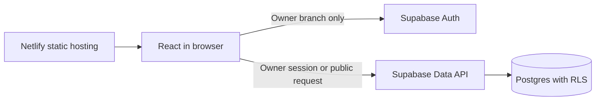

# Design Document

Draft for review after [requirements](requirements.md). The [implementation plan](tasks.md) follows the workshop's React/Vite stack and uses the [supplied SQL](../../../../supabase/01_schema_rls.sql) as the database contract. The schema was applied in the Supabase SQL Editor per the project owner. Confirm live Auth and Data API behavior during implementation.

## Supabase connection decision

Use `@supabase/supabase-js` v2 in React for the workshop. The browser uses HTTPS to reach Supabase Auth and the Data API. Supabase uses the student's session to evaluate `auth.uid()` and RLS. Netlify serves the static build. [Supabase React quickstart](https://supabase.com/docs/guides/getting-started/quickstarts/reactjs)

| Option | Fit for MyCV Studio |
| --- | --- |
| React/Vite with Supabase SDK | Fits the static lab app and existing RLS. Uses a project URL and publishable key. |
| Server-rendered framework with Supabase | Useful if a later feature needs server rendering or server-side sessions. Adds a server runtime and session handling to the workshop. |
| Direct PostgreSQL or pooler | Requires a trusted process and database credentials. Per-student authorization would need separate design. |
| Supabase MCP in Kiro | Optional development tooling for a dedicated lab project. A project-scoped, read-only connection can inspect schema. The deployed browser uses the SDK. |

[Supabase SSR clients](https://supabase.com/docs/guides/auth/server-side/creating-a-client) · [Postgres connections](https://supabase.com/docs/guides/database/connecting-to-postgres) · [Supabase MCP](https://supabase.com/docs/guides/ai-tools/mcp)

## React components and data flow

| Component | Responsibility |
| --- | --- |
| `App` | Selects the public branch when the `cv` query parameter is present. Otherwise opens the owner branch. |
| `CvEditor` | Restores or starts the session, loads the owner's CV and renders the editor sections. |
| `ProfileForm` | Validates and saves CV fields. |
| `ProjectsSection` | Lists projects, edits project fields and confirms deletion. |
| `PublishPanel` and `PublicCv` | The panel updates publication and presents the link. The public view loads and displays published data. |

**Owner flow.** Create the owner client on the editor branch and restore the browser session with `getSession()`. Call `signInAnonymously()` from **Start my CV** and disable the button while it is pending. Use the session user ID to filter reads because authenticated users can also read published rows. If the owner CV is missing, insert using schema defaults. On a duplicate-owner conflict, reload the existing row without overwriting it. If sign-in succeeds but draft creation fails, retry with the existing session.

**Public flow.** Use a dedicated client with session persistence, refresh and URL-based session detection disabled. Validate the UUID before querying. Select explicit display fields from `cvs` using both `id` and `published = true`. If the CV is visible, load its projects by `cv_id`, newest first. Treat empty CV results as unavailable and network errors as retryable. Keep the public branch independent from editor session and draft state.

## Database contract and validation

| Table | Contract |
| --- | --- |
| `public.cvs` | One row per `owner_id`. The database assigns ownership from `auth.uid()` and defaults `published` to `false`. Editable fields are `full_name`, `headline`, `summary`, `university`, `degree`, `location`, `skills`, `github_url` and `linkedin_url`. Update `published` separately. |
| `public.projects` | Each project references `cvs.id` through `cv_id`. The database assigns `owner_id` and verifies ownership of the parent CV. Writable fields after creation are `title`, `description`, `tech_stack` and `project_url`. Sort by `created_at` descending. |

1. Use explicit read columns and write fields. Scope owner mutations to the current record and owner. Check the Supabase error and verify the expected row was affected before showing success.
2. Profile limits are name 100, headline 160, summary 1,200, university 150, degree 150, location 100 and skills 500 characters. Project limits are trimmed title 1–120, description 800 and tech stack 250. A published CV must keep a non-blank name.
3. Trim optional links and require a parseable HTTP(S) URL with a host. Apply the same check when rendering links because the SQL constraint checks only the scheme prefix. Save empty optional fields as empty strings. Split comma-delimited skills and tech stack for display.

## Configuration and verification

1. Enable anonymous sign-ins for the lab Supabase project. Set `VITE_SUPABASE_URL` and `VITE_SUPABASE_PUBLISHABLE_KEY` in the existing ignored `kiro-student/.env.local`. Show a setup error if either value is missing. Vite reads these at build time. Restart the dev server or rebuild after changing them. [Supabase anonymous sign-ins](https://supabase.com/docs/guides/auth/auth-anonymous) · [Vite environment variables](https://vite.dev/guide/env-and-mode.html)
2. Use fictional data. Verify the owner, a second signed-in user and a sessionless visitor through the browser/Data API so the tests exercise RLS. A successful SQL Editor query uses elevated access and cannot establish those outcomes. Recheck draft, published and unpublished states on fresh public requests. [Workshop test worksheet](../../../../04_Testing_and_Troubleshooting.md)
3. Run `npm run build` in `kiro-student/`, upload the generated `dist/` manually, then check the Netlify HTTPS URL and public link. Use the same hosted origin for later redeploys to retain the local editing session. [Netlify manual deploys](https://docs.netlify.com/deploy/create-deploys/#drag-and-drop)
